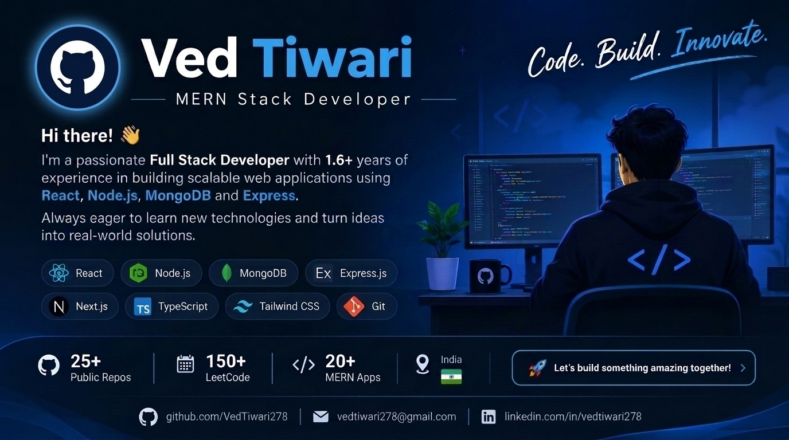

<!-- Custom Hero Banner -->

  

<!-- Compact Live Badges & Quick Navigation -->

  

  <a href="#-featured-projects">Featured Projects</a> &nbsp;&bull;&nbsp;
  <a href="#-engineering-stack">Tech Stack</a> &nbsp;&bull;&nbsp;
  <a href="#-focus--highlights">Focus &amp; Milestones</a> &nbsp;&bull;&nbsp;
  <a href="#-github-analytics">Analytics</a> &nbsp;&bull;&nbsp;
  <a href="#-lets-connect">Connect</a>

 

## ✨ Featured Projects

<table>
  <tr>
    <td width="50%" valign="top">
      <h3>🍽️ Campus Craving (Major Project)</h3>
      
Full-fledged food ordering &amp; commercial marketplace platform engineered for real-world business operations.

      

        
        
        
        
      

      

        <a href="https://github.com/VedTiwari278/MAJOR_PROJECT"><b>Source Code</b></a> &nbsp;&bull;&nbsp;
        <a href="https://major-project-one-alpha.vercel.app"><b>Live Demo ↗</b></a>
      

    </td>
    <td width="50%" valign="top">
      <h3>📱 QR-Based Canteen System</h3>
      
Smart QR-driven ordering &amp; delivery management system designed for fast, queue-free campus canteen service.

      

        
        
        
      

      

        <a href="https://github.com/VedTiwari278/Qr_Based_Canteen"><b>Source Code</b></a> &nbsp;&bull;&nbsp;
        <a href="https://qr-based-canteen.vercel.app"><b>Live Demo ↗</b></a>
      

    </td>
  </tr>
  <tr>
    <td width="50%" valign="top">
      <h3>🎵 Sargam (Web + Mobile Ecosystem)</h3>
      
Hybrid MERN &amp; React Native platform connecting a mobile user experience with a dedicated web admin console.

      

        
        
        
      

      

        <a href="https://github.com/VedTiwari278/Sargam"><b>Source Code ↗</b></a>
      

    </td>
    <td width="50%" valign="top">
      <h3>✉️ Email &amp; OTP Microservice</h3>
      
Reusable transactional email &amp; 6-digit OTP verification API service built for modern full-stack authentication flows.

      

        
        
        
      

      

        <a href="https://github.com/VedTiwari278/EMAIL-AND-OTP-SERVICES"><b>Source Code ↗</b></a>
      

    </td>
  </tr>
</table>

| More Shipped Work | Description | Links |
| :--- | :--- | :--- |
| **🔗 URL Shortener** | Fast, clean link shortening service deployed on Vercel | [Repo](https://github.com/VedTiwari278/URL_Short) • [Live ↗](https://url-short-liart.vercel.app) |
| **🌐 Developer Portfolio** | Personal web portfolio built with Express & EJS | [Repo](https://github.com/VedTiwari278/MYPORTFOLIO) • [Live ↗](https://myportfolio-ap7t.onrender.com) |
| **🤖 ML Programs** | Practical Python machine learning notebooks & experiments | [Explore ↗](https://github.com/VedTiwari278/Machine_Learning_Programs) |

 

 

## 🛠️ Engineering Stack

<table>
  <tr>
    <td width="180" align="center"><b>Frontend &amp; Mobile</b></td>
    <td>
      
    </td>
  </tr>
  <tr>
    <td width="180" align="center"><b>Backend &amp; Databases</b></td>
    <td>
      
    </td>
  </tr>
  <tr>
    <td width="180" align="center"><b>Cloud, DevOps &amp; Design</b></td>
    <td>
      
    </td>
  </tr>
</table>

 

## 🧭 Focus & Highlights

<table>
  <tr>
    <td width="50%" valign="top">
      <h4>⚡ Currently Exploring</h4>
      <ul>
        <li><b>Real-Time Systems:</b> WebSockets, live dashboards &amp; session sync</li>
        <li><b>Architecture:</b> System Design, Microservices &amp; clean API contracts</li>
        <li><b>Modern Web:</b> Next.js App Router, Server Components &amp; TypeScript</li>
        <li><b>UI/UX Craft:</b> Clean, responsive interfaces with Tailwind &amp; Figma</li>
      </ul>
    </td>
    <td width="50%" valign="top">
      <h4>🏆 Engineering Milestones</h4>
      <ul>
        <li><b>20+ Full-Stack Apps:</b> Shipped from database schema to cloud deploy</li>
        <li><b>150+ LeetCode Problems:</b> Strong foundations in DSA &amp; problem solving</li>
        <li><b>Cross-Platform:</b> Built web + React Native mobile ecosystems</li>
        <li><b>Cloud Deployments:</b> Production apps on AWS, Vercel &amp; Render</li>
      </ul>
    </td>
  </tr>
</table>

 

## 📊 GitHub Analytics

<!-- Profile Details & Contribution Timeline -->

 

<!-- Stats & Languages Side-by-Side -->

 

<!-- Contribution Streak -->

 

## 🤝 Let's Connect

Open to **full-stack engineering roles**, **freelance & consulting**, **hackathons**, and **startup collaborations**.

 

  

  

Code. Build. Innovate. &nbsp;&bull;&nbsp; ⭐ Star a repo if something here helped or inspired you!

